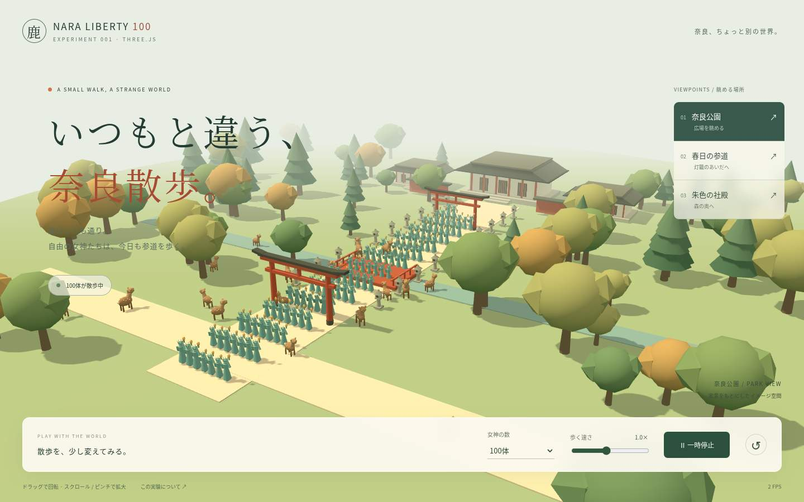
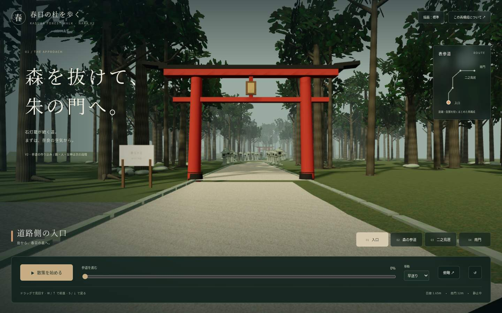
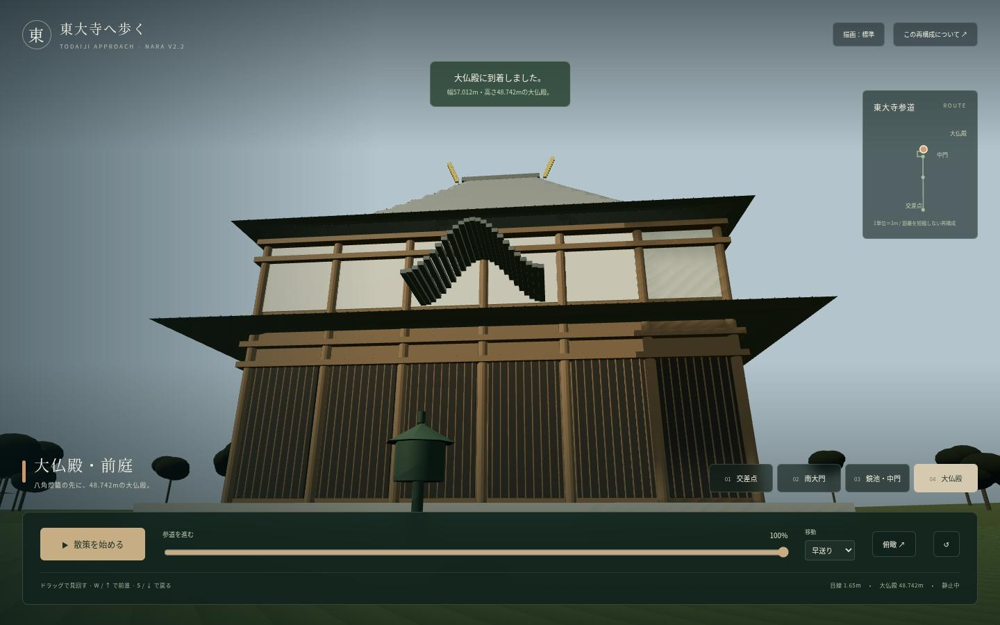

# 奈良を100人で歩く自由の女神

同じ企画の試作をバージョンごとに保存する場所です。各版の画像・説明・コード・実行方法をまとめています。

最新の試作: [Ver2.2 — 東大寺へ歩く](v2.2/README.md)。大仏前交差点から南大門・鏡池、西側の拝観入口、大仏殿前庭へ進む初期版を実装しました。V1・春日大社版V2は比較用に保持しています。

Ver2.2の参照セット: [テスト計画書](docs/ver2.2-test-plan.md) · [赤枠付きの再現範囲画像](assets/references/ver2.2/todaiji-ver2.2-reproduction-area.png) · [画像の保存記録](assets/references/ver2.2/README.md) · [Blender確認結果](docs/ver2.2-blender-check.md)。画像原本は保存済みです。

```text
experiments/20261010-nara-liberty-100/
├── README.md
├── v1/   # 奈良の箱庭＋100体の自由の女神
│   ├── assets/site-preview.jpg
│   ├── docs/
│   └── src/
├── v2/   # 春日大社の参道・南門を作り込む
    ├── assets/site-preview.jpg
    ├── docs/
    └── src/
└── v2.2/ # 東大寺周辺のメートル尺度の散策
    ├── assets/site-preview.jpg
    ├── public/models/
    ├── scripts/
    ├── docs/
    └── src/
```

## V1 — 100体の自由の女神



手作りの奈良の箱庭に100体の女神が歩く初期試作。数・速度・視点を変えて試せます。

[V1の説明と起動方法](v1/README.md) · [V1のサイト](https://nara-liberty-100.vercel.app/)

## V2 — 春日大社の参道



道路側から森と石灯籠の参道を歩き、南門へ到着する試作。鹿・人・女神の前に、奈良の背景を作り込む段階です。

[V2の説明と起動方法](v2/README.md) · [V2のサイト](https://kasuga-forest-v2.vercel.app/) · [V1レビューと次の方針](v2/docs/v1-review.md)

公開サイトはVercelの閲覧保護があるため、所有者のログインまたはチャットで渡した期限付き共有リンクが必要です。

## 保存と比較

2026-10-10の依頼で、従来の2つの実験フォルダをこの企画の下の `v1/` と `v2/` にまとめました。各版は独立した依存定義・文書・テストを持ちます。移動時にアプリのコードは変更していません。公開先もそれぞれ別です。

画像は実際のローカルChromium画面で、各版の `assets/` に参考ファイルとして保存しています。画像だけでは操作や動きは分からないため、サイトで確認してください。今後の試作もバージョンを分けて保存します。

## Ver2.2 — 東大寺へ歩く



南大門と大仏殿の公式寸法を使い、人の目線で大きさを確認する初期版。地理位置・標高・外観の細部は推定を含みます。

[説明と起動方法](v2.2/README.md) · [Ver2.2のサイト](https://todaiji-nara-v2-2.vercel.app/) · [検証結果](v2.2/docs/validation.md)
