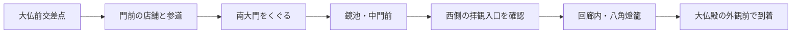

# Ver2.2 取込計画 — 大仏前交差点から東大寺大仏殿周辺

作成日: 2026-10-11 日本時間。
状態: 方針をユーザー確認済み。資料整理・制作環境確認中。東大寺の3D実装・データ変換・デプロイには未着手。

関連資料: [テスト計画書](ver2.2-test-plan.md) · [赤枠画像の保存先と範囲記録](../assets/references/ver2.2/README.md) · [制作環境確認](ver2.2-blender-check.md)

2026-10-11の追加指示: 交差点〜大仏殿を重点的にリアルにし、周辺は粗めでよい。造形の細かさよりも縮尺・位置関係を優先する。周辺を簡略化する場合も位置や大きさを都合よく変えない。

## 目的と変更点

ユーザーの想定していた奈良は春日大社の参道ではなく、大仏前の交差点から東大寺大仏殿周辺だった。Ver2.2では添付画像の赤枠を対象に、現実に近い奈良の背景を作る。シュールな女神を置く前に、街の入口・参道・池・巨大な木造建築が自然につながることを優先する。

V1と春日大社版V2は比較資料として保持。Ver2.2は同じ企画の新しい版として独立させる。鹿・人・車・自由の女神の動きは今回の背景作成に混ぜず、後の段階にする。

## 添付画像から読み取った範囲

赤枠を範囲の根拠とする。境内図は案内用の絵地図であり、ピクセルをそのままメートルや緯度経度へ変換しない。赤枠の四隅の実座標・面積・ルート距離は現時点で未計測。

| 範囲 | 取り込む内容と扱い |
| --- | --- |
| 南側 | 大仏前交差点、春日大社表参道側の道路・公園縁、東大寺へ入る参道 |
| 中央 | 門前の店舗、東大寺ミュージアム周辺、南大門、鏡池、中門・回廊、大仏殿前庭、大仏殿 |
| 西側 | 戒壇院・勧進所側の建物群、塀、木立、道。最初は配置と外形を再現 |
| 東側 | 東塔跡・芝地、国際フォーラム周辺、鐘楼・俊乗堂側の斜面と建物群。最初は地形と外形を再現 |
| 北側 | 大仏殿と周辺まで。赤枠上端を目安とし、講堂跡・大仏池付近は実座標との照合で境界を確定 |

二月堂・法華堂の中心部は赤枠の東縁にかかる、または外側と読み取れるため、Ver2.2の重点再現には含めない。必要なら遠景として置く。正倉院・転害門・若草山全体・春日大社への延伸は対象外。境界の解釈は最初の配置図で見えるようにし、配置を確認してから作り込む。

**赤枠全体を同じ細かさで作る計画ではない。赤枠の全体配置と、歩く主ルートの詳細再現を両立させる。** 周辺を省略する場合は省略箇所を明示する。

## 主ルートと体験



目線は1.65m。交差点から北へ進み、店舗の間から南大門が見え、門をくぐった先で鏡池と大仏殿への空間が開ける体験にする。大仏殿は南大門より大きい建物として見える必要がある。

中門の中央を常時通れる通路として決め打ちしない。公式境内図では入口・出口が別にあり、公式案内にも西側スロープの記載がある。通常の拝観入口を追加写真と図で確認し、入口へ回り込む経路を設定する。大仏殿の堂内・大仏像は初回の詳細再現に含めず、外観前庭までをゴールとする。拝観料金の支払いなどの機能は作らない。

V2の自動散策・停止・地点移動・見回し・俯瞰を活用する。ルート外の自由移動は初回の必須要件にせず、周辺の様子は俯瞰で確認できるようにする。実際の参拝案内やナビゲーションとしての正確さは保証しない。

## 資料の取り込み方

| 資料 | 用途 | 現在の状態 |
| --- | --- | --- |
| ユーザー添付の赤枠画像 | 対象範囲を決める | チャット内で確認済み。測量資料としては扱わない |
| 東大寺公式の境内図PDF | 地名・ランドマーク・通路・入口出口の関係 | 配布元・PDFを確認済み |
| 公式の大仏殿・南大門の解説 | 建物の寸法と構造の特徴 | 確認済み |
| 地理院地図・空中写真・標高資料 | 実座標、道の長さ、敷地形状、斜面 | 使える計測機能を確認。対象地域の座標抽出・計測は未実施 |
| 地上からの参考写真 | 屋根、木材、道幅、店舗、視線の抜け | 今回の造形照合用の画像セットは未収集 |
| PLATEAU等の公開3Dデータ | 周辺建物の外形を補う候補 | 配布サービスを確認。奈良の対象区域・精度・利用条件は未確認 |

PDFを読み込むだけでリアルな3Dの街は生成できない。PDFは配置関係、実座標の地図は距離、地上写真は外観、公式寸法は大きさの根拠として分担する。

追加で確認した資料入口:

- [奈良市都市計画基本図（白地図）](https://www.city.nara.lg.jp/soshiki/111/7227.html): 縮尺1:2,500、2007年12月調整の資料。古いため、建物や道路の現況確認には単独で使わない。対象図郭の選定・計測はこれから行う。
- [奈良市地図情報公開サイトの説明](https://www.city.nara.lg.jp/soshiki/6/94247.html): 地形図、航空写真、道路台帳図、市認定道路網などの公開レイヤーを案内している。東大寺周辺で各レイヤーが利用できるか、更新日と利用条件を確認してから採用する。
- [奈良市都市計画情報の検索・印刷](https://www.city.nara.lg.jp/soshiki/111/7260.html): 縮尺を選べる地形図・都市計画図の案内。都市計画道路は計画線であり、現に存在する道路の形と混同しない。

資料の優先順位は、対象地点の地形図・航空写真による配置、公式建築寸法、地上写真による外観。都市計画資料は補助に使う。写真の遠近感だけから座標や建物の大きさを決めない。

取り込み時は資料ごとにURL・確認日・用途・利用条件・取得できた内容を記録する。公式ページには画像等の二次利用制限があるため、今回の計画ではリンク参照と独自モデル制作を基本とし、公式PDFや画像をそのまま公開アプリ・公開リポジトリへ転載する前提にしない。公開用の写真テクスチャ（模型表面に貼る画像）を採用する場合は、利用可能な素材を選び出典と条件を記録する。

## 実装方法

### 1. 実際の配置を3Dの座標にする

大仏前交差点・南大門・中門・大仏殿・鏡池・主要分岐の緯度経度を地図で確認する。交差点付近を原点とし、局所的なメートル座標へ変換。Three.jsでは1単位=1m、X=東、Y=高さ、Z=南として管理する。資料で確認した値と推定値をデータ上でも区別する。

道の中心線と幅、建物の輪郭、池の形、植生領域を別々のデータにする。V2の約241mに短縮したルートは流用しない。今回は距離をまず実寸に寄せ、散策速度・地点ジャンプで操作時間を調整する。正確な距離と標高が取れない箇所は暫定値と明示する。

### 2. 地形と街並みを組む

参道だけでなく道路、交差点、歩道、石畳・砂利の切替、側溝、店舗の並び、塀、芝地、鏡池を作る。東側の高低差は標高資料から確認。細かな段差や石段は写真を補助にし、広域の標高データから勝手に精密な石段を推定しない。

交通は最初は道路・横断歩道・信号など静的な形だけ。車を走らせる場合も参道の歩行区域には入れない設計にする。車の動き自体は後の段階。

### 3. 東大寺らしさを決める建築を作る

南大門と大仏殿は専用モデルを作る。春日大社の朱色の南門を拡大して代用しない。南大門は大きな木の柱と貫（柱をつなぐ横材）、深い軒、門の下から見える構造を重点にする。大仏殿は横幅、巨大な二重屋根、中央の唐破風（曲線を持つ屋根部分）、色と軒の陰影を重点にする。

| 建物 | 公式資料で確認できた尺度 | モデルへの適用 |
| --- | --- | --- |
| 南大門 | 基壇上から25.46m、柱18本、柱の長さ19.058m | 高さの起点を基壇上にする。総高さと柱の長さを混同しない |
| 大仏殿 | 東西57.012m、南北50.480m、高さ48.742m | 外形寸法の基準。屋根端・基壇など寸法の対応箇所は追加資料で照合 |

最初に簡単な箱・柱で寸法と見え方を確認し、その後に屋根や木材の形を作り込む。南大門の仁王像は重要な特徴だが、精密な人物彫刻は別工数。初回は左右の安置区画と資料に基づく概形までとし、詳細造形は後の段階。八角燈籠も場所と外形を先に合わせる。周辺建物は輪郭・屋根・壁を低い細かさで揃える。

### 4. 使う技術と再利用

現在のJavaScript・Three.js・Viteを継続。Reactへの移行はこの範囲変更に必要ない。V2から入力、散策、地点移動、画質切替、説明画面、テストの仕組みを再利用する。春日大社の建物・ルート・植生配置は新規に作る。

Blender 4.3.2はこのクラウド環境で実行できることを確認済み。GUIを開かずPythonで模型を作り、GLBへ書き出せる。1mの試験模型がThree.jsで1×1×1m・Y上向きとして読み込めることを確認した。ユーザーのPC上のBlenderとの接続や追加プラグインはこの制作方法では不要。非圧縮GLBの制作経路は確認済みだが、写真からの自動復元・精密な建築制作・実際のブラウザでのモデル表示は別工程。

データは配置用JSON、建築はThree.jsの形状生成から始める。複雑な屋根や彫刻に限りBlender（3D模型を作るソフト）等で作成し、GLB（ブラウザへ渡せる3Dファイル）で読み込む方法を候補とする。PLATEAUの対象データが適合すれば周辺外形に使い、なければ手作りの外形で進める。公開3Dデータの取得可否を完成の必須条件にしない。

遠い建物を簡略化するLOD（距離で細かさを切り替える方法）、樹木のInstancing（同じ形をまとめて描く方法）、静止中の描画休止を使う。広い赤枠の全建物を常に最高精細で描画しない。

## 作成の順番と確認地点

| 段階 | 作るもの | 次へ進む前に確認すること |
| --- | --- | --- |
| A: 資料・座標整理 | 範囲境界、主要座標、寸法表、写真の一覧 | 添付の赤枠と対象地点が対応し、推定値が分かる |
| B: 全体の仮配置 | 赤枠全体の地形・道・池・建物の簡単な外形 | 主ルートがつながる、南大門と大仏殿の位置・高さ・見え方が自然 |
| C: 主ルート詳細 | 交差点、店舗、参道、南大門、鏡池、中門・回廊、前庭、大仏殿外観 | 写真と見比べて、春日大社ではなく東大寺だと分かる |
| D: 周辺と画面仕上げ | 西側・東側の外形、植生、標高、材質、操作画面 | 赤枠周辺も空白のままにせず、重点区域との差を説明できる |
| E: 検証・公開 | ブラウザ操作テスト、スクショ、README、別公開先 | 確認済み・未確認を記録し、V1・V2・Ver2.2を比較できる |

最初のレビュー対象はBの仮配置。細部を増やす前に「この位置関係・大きさの奈良で合っているか」を画像で確認する。工数は写真の取得状態とモデル精度に左右されるため、現時点では完了時間を確約しない。

## フォルダと公開

この計画書は企画の `docs/ver2.2-plan.md` に置く。実装時に `v2.2/` を追加し、V1・V2を保持する。

```text
experiments/20261010-nara-liberty-100/
├── README.md
├── docs/ver2.2-plan.md     # 今回作成する計画
├── v1/                   # 保存
├── v2/                   # 春日大社版を保存
└── v2.2/                 # 実装時に追加
    ├── README.md
    ├── docs/             # 要件・仕様・検証記録
    ├── assets/           # READMEの実画面・参考ファイル説明
    ├── public/models/    # 必要な場合の配信用3Dモデル
    ├── src/data/         # 地形・道・建物・配置
    ├── src/              # 描画・操作
    └── tests/
```

配信用の素材はViteのpublic配下、README用の画像はassets配下に分ける。未整理の参考資料はscratchへ置き、出典一覧を文書に残す。実装後のスクリーンショットをREADMEのサムネイルにする。今はサイトが存在しないので完成画像や公開URLを作らない。公開時はVer2.2専用のVercelプロジェクトを作り、既存2版の公開先を保持する。

## 完成の判定と検証方法

- 交差点から南大門をくぐり、鏡池・中門周辺から大仏殿外観前まで進める。
- 主ルートの位置関係と建物の尺度が根拠資料に対応し、仮配置段階から無断で道を短縮しない。
- 交差点、南大門手前、南大門内部、鏡池付近、大仏殿前の同じ目線でスクリーンショットを撮り、参考写真と比較する。
- PC 1440×900とスマホ幅390×844の実際のChromiumで、開始停止・前後移動・視点・地点移動・俯瞰・リセット・横はみ出し・ページ例外・素材の読込失敗を確認する。
- 南大門の柱や池、回廊を歩行ルートが貫通しない。門の下や屋根の裏側も描画される。主要地点で建物が不自然に消えない。
- 画質標準での操作性を確認。PCの実GPUで30FPS、スマホで20FPSを初期目標とするが、未測定の目標で保証値ではない。クラウドのSwiftShaderによる機能テストと実機の速度計測を区別する。
- 公開状態だけでなく公開URLでの描画も可能な範囲で確認。通信制限で検証できない場合は、同じソースのローカル確認と区別して報告する。

## 追加であると助かる写真

交差点から北を向いた入口、店舗の並ぶ参道、南大門の正面と門内、南大門を抜けた先、鏡池と中門、拝観入口、大仏殿の正面・斜め方向。現場訪問は必須ではなく、ネットのページURLだけでも配置と外観の参考になる。今回の境内図で計画は作れるが、材質・屋根・道幅をリアルにするには地上写真が必要。

## 参照元と確認状況

2026-10-11に確認。

- [東大寺公式・資料ダウンロード](https://www.todaiji.or.jp/download/#keidai): ユーザー指定の配布元。
- [同ページが現在リンクする境内案内図PDF](https://www.todaiji.or.jp/pdf/map.pdf): 1ページ。地名、配置関係、入口・出口等を参照。添付の案内図と版が同じとは断定しない。
- [東大寺公式・境内案内図](https://www.todaiji.or.jp/information/keidai/): 西側スロープと周辺の高低差を確認。
- [東大寺公式・南大門](https://www.todaiji.or.jp/information/nandaimon/): 高さ・柱・構造の根拠。
- [東大寺公式・大仏殿](https://www.todaiji.or.jp/information/daibutsuden/): 建物寸法と八角燈籠の根拠。
- [東大寺公式・交通案内](https://www.todaiji.or.jp/access/): 参道への車両進入制限の確認先。
- [国土地理院・地理院地図の機能](https://maps.gsi.go.jp/help/intro/kinolist/): 緯度経度・標高・計測機能の確認。
- [国土地理院・距離等の計測](https://maps.gsi.go.jp/help/intro/kinolist/3-keisoku.html): 距離・面積を実装前に測る方法。
- [国土交通省・PLATEAUオープンデータ](https://www.mlit.go.jp/plateau/open-data/): 任意の追加候補。今回の範囲に使えるデータの取得は未実施。
