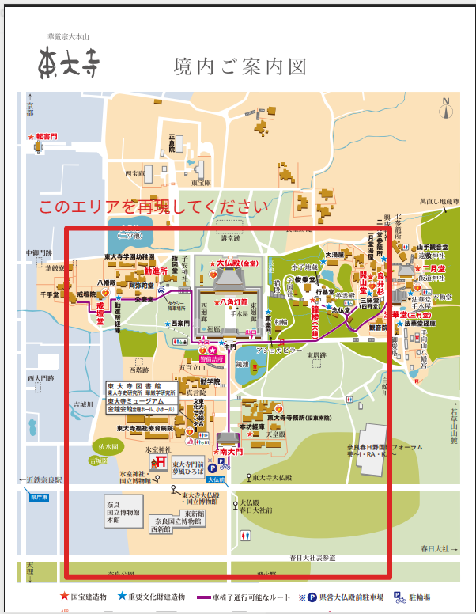

# Ver2.2 テスト計画書

作成日: 2026-10-11 日本時間。東大寺シーンの検証は未実施。

[取込計画](ver2.2-plan.md)と[ユーザーの赤枠画像](../assets/references/ver2.2/todaiji-ver2.2-reproduction-area.png)を一組として使う。原本は2026-10-11に保存済み。[保存記録](../assets/references/ver2.2/README.md)にファイル名・ハッシュ・保存日を記録した。以下は実装時の判定基準。

S01の原本保存と計画書・本書からの参照は確認済み。座標への対応付け・シーンの実装検証はこれから行う。

## 最優先: 範囲・縮尺・位置関係

| ID | 確認内容 | 証拠と合格条件 |
| --- | --- | --- |
| S01 | 赤枠の原本保存 | 元画像を保存し、ファイル名・ハッシュ・保存日を記録。取込計画と本書から同じ画像へ参照できる |
| S02 | 区域の対応付け | 赤枠と主要ランドマークを実地図へ照合。地図の版・縮尺・北の向き・座標系を記録 |
| S03 | 主要位置 | 交差点・南大門・鏡池・中門・大仏殿の採用座標と出典を一覧化。全地点が同じメートル座標へ変換される |
| S04 | 距離・方角 | 交差点→南大門→中門→大仏殿の区間距離を地図で測り、モデル内距離と比較。比較先と測った点の定義を一致させる |
| S05 | 主要建物の寸法 | 南大門の基壇上高さ25.46m、大仏殿57.012×50.480×48.742m。測定対象の端を資料と合わせ、モデルの外形を数値検証 |
| S06 | 変換と縮尺 | Blenderの単位、GLB出力、Three.jsの1単位=1mを確認。1m試験模型で全軸1m、Yが上、地面がY=0となる |
| S07 | 視点と地形 | 目線1.65m、採用標高に追従。地面への埋まり、階段での飛び、建築の大きさを隠す不自然な広角補正がない |
| S08 | 周辺の簡略化 | 形・材質の細かさは落としてよい。位置・外形寸法・斜面・道の接続を勝手に変えていない |

初期目標: 入力座標からモデル座標への変換誤差0.1m以内、資料と対応箇所が確定した建築外形寸法の誤差1%以内、地図計測とモデル内区間距離の差1%以内。これは「現地に対してその精度がある」という保証ではない。元資料の解像度、年代、座標の読取り誤差を別に記録する。採用資料が不十分な地点を数値だけ合わせて合格扱いにしない。

## 見た目とルート

| ID | 確認内容 | 証拠と合格条件 |
| --- | --- | --- |
| V01 | 交差点と入口 | 北向きの実写真と同じ方向のモデル画面を比較。道路・参道・店舗の並びが対応 |
| V02 | 南大門 | 正面と門内の目線画面。高さ、木組み、屋根、門を抜ける際の見え方が自然 |
| V03 | 鏡池・中門 | 池と参道・門の位置関係が対応。水面や回廊を歩行ルートが貫通しない |
| V04 | 大仏殿 | 正面・斜め方向の画面で二重屋根と外形を比較。建物寸法はS05で別途検証 |
| V05 | 主ルートの精細さ | 交差点〜大仏殿を重点に材質と陰影を確認。周辺の粗さを主ルートで隠れなく露出させない |
| V06 | 入口経路 | 通常の拝観入口を資料で確認し、西側へ回る経路を検証。中門中央が常時開いている設定にしない |

写真ごとにURL・撮影方向・確認日を記録。写真の遠近感を合わせるために地図で確認した座標を動かさない。見た目の評価は本人の確認と組み合わせ、自動テストだけで写実性の達成としない。

## 操作・配信

- F01: 実ChromiumでPC1440×900・スマホ幅390×844を確認。
- F02: 散策開始停止、前後移動、ドラッグ見回し、地点ジャンプ、俯瞰往復、入口リセット。
- F03: 横はみ出し、スマホボタン、説明画面、キーボード操作。
- F04: ページ例外0、GLB・画像の読込失敗0、モデル欠け・裏面欠けがない。
- F05: タブ非表示時の散策停止、静止時の描画休止、画質切替。
- F06: 標準画質で実GPUの速度を測定。PC30FPS・スマホ20FPSは初期目標。SwiftShaderでの機能確認を実機速度の証拠にしない。
- F07: 公開先で同じ操作を確認。通信制限で未検証の場合はその範囲を明示。
- F08: V1・V2のコードと公開先を保持し、Ver2.2が独立して起動できる。

## 記録と判定の順番

1. S01〜S06の資料・尺度を先に確定し、主要建物を仮配置して画像を共有する。
2. 主ルートを作り込み、S07〜S08・V01〜V06を確認する。
3. ブラウザ機能、公開先、スクリーンショットを確認し、結果表を保存する。

記録項目: ID、結果（合格・不合格・未確認）、ソースのコミット番号、使用資料・版、計測値、誤差、画像パス、実行環境、残る課題。未確認を合格に変えない。READMEのサムネイルは実装後の実画面を使う。
